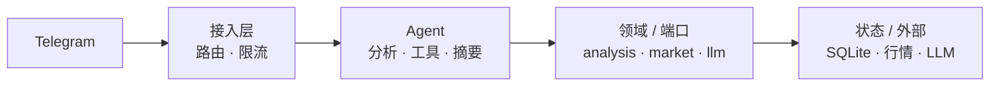

# guanlanai

观澜（GuanLanAI）是一个运行在 Telegram 私聊和群组中的 AI 辅助交易机器人，使用 Go 编写。

当前项目处于早期阶段：用户使用自己的 API Key（支持 OpenAI 兼容代理地址），输入加密货币代码即可获得交易观点，暂不支持下单，也暂不支持股票。部署目标是一台甲骨文免费 VPS，可同机运行生产与测试 bot。

## 使用

扫描二维码或直接打开 [@GuanLanAI_bot](https://t.me/GuanLanAI_bot)：

<p align="center">
  <a href="https://t.me/GuanLanAI_bot">
    
  </a>
</p>

## 架构



完整的运行时架构、分析流程、追问流程和部署拓扑见 [docs/ARCHITECTURE.md](docs/ARCHITECTURE.md)。

## 当前进度

Phase 0 已完成：Go 骨架、环境配置、SQLite 迁移、`/healthz` / `/readyz`、Dockerfile、Compose 和部署目录。

Phase 1 已部署到生产和测试环境：Telegram long polling、私聊限制、per-chat 串行队列和基础命令。

Phase 2 已部署到生产和测试环境：`/key`、AES-256-GCM 加密存储、收到 Key 后删除消息、`/baseurl` 兼容代理、`/model`、`/mode` 和 SSRF 防护。

Phase 3 已部署：Binance USDT 现货行情、多周期技术指标、支撑阻力，以及 `gpt-5-mini` 结构化观点卡片。staging 已验证 BTC/SOL/BNB，生产已切换。

Phase 4 已部署：会话上下文、分析后追问、自动摘要裁剪、每用户限流、全局 LLM 并发和 usage 记录。

Phase 5 已部署：新增 `guanlanai backup`（SQLite `VACUUM INTO`）、观点长度上限和运维文档；备份命令已在 staging 验证。

技术指标新增多周期 SuperTrend（ATR 10、乘数 3），LLM 可直接引用线位、方向、距离和翻转后的 K 线数；当前生产/测试镜像为 `guanlanai:sessions-v4`。

会话模型 Phase A/B 已部署到 prod/staging：私聊多会话（`/new`、`/sessions`、`/switch`、`/rename`、`/delete`）和群组按成员隔离会话；镜像 `guanlanai:sessions-v4`，群组通过 `GROUPS_ENABLED=true` 开启。

Agent 能力已增强：追问支持最多 3 轮只读工具调用（行情快照、技术分析、代码解析），分析输出优先使用 JSON Schema 并保留本地校验兜底，追问支持 Telegram 流式编辑；每个请求带 `trace_id`，并新增固定 fixture 的 golden-case 回归测试。对应配置为 `AGENT_MAX_TOOL_ROUNDS` 和 `LLM_STREAMING`。

安全加固已部署到 prod/staging：镜像 `guanlanai:guardrails-v1`，包含提示词注入防护、不可信内容分隔、工具调用/输入预算和日志脱敏；后续 P1 清单见 [docs/SECURITY.md](docs/SECURITY.md)。

## 开发

```sh
cp .env.example .env   # 首次
make test
make build
make run               # 自动加载 .env
make docker            # 构建本机架构镜像
```

- 产品边界与技术约定见 [AGENTS.md](AGENTS.md)
- 详细规划、架构、里程碑与验收标准见 [docs/PLAN.md](docs/PLAN.md)
- VPS 部署步骤见 [deploy/README.md](deploy/README.md)
- 日常运维、备份与回滚见 [docs/OPERATIONS.md](docs/OPERATIONS.md)
- 上线验收报告见 [docs/ACCEPTANCE.md](docs/ACCEPTANCE.md)
- 私聊多会话/群组会话设计见 [docs/SESSION_DESIGN.md](docs/SESSION_DESIGN.md)
- 分析周期与个人偏好设计见 [docs/ANALYSIS_PROFILE_DESIGN.md](docs/ANALYSIS_PROFILE_DESIGN.md)
- 运行时架构、分析/追问流程和部署拓扑见 [docs/ARCHITECTURE.md](docs/ARCHITECTURE.md)
- 安全边界、提示词注入防护与 P1 待办见 [docs/SECURITY.md](docs/SECURITY.md)
