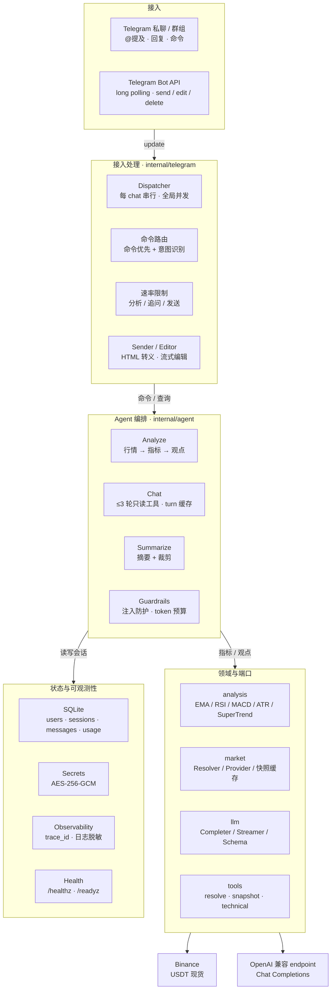
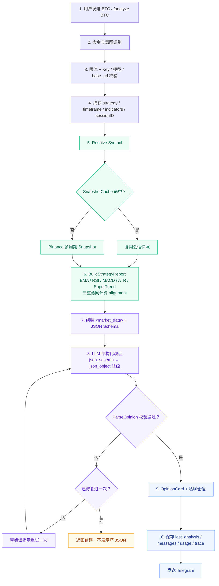
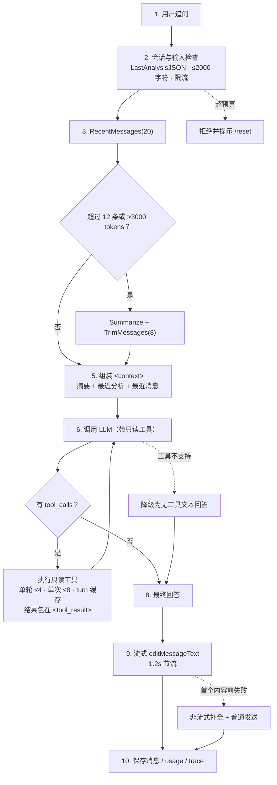
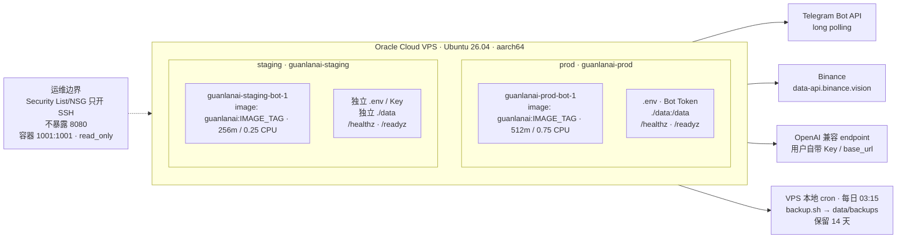

# 架构与流程

本文用 Mermaid 说明观澜当前的运行时结构、两条 LLM 路径和部署拓扑。图直接写在 Markdown 里，方便随代码迭代修改。设计细节和里程碑见 [PLAN.md](PLAN.md)，安全边界见 [SECURITY.md](SECURITY.md)。

## 1. 运行时架构

分层原则：

- **接入层**只负责 Telegram update、命令路由、限流、发送和流式编辑，不直接依赖行情或 LLM 实现。
- **Agent 编排层**负责分析管道、追问工具循环、摘要和护栏；它依赖 `market`、`llm`、`analysis`、`session` 的接口。
- **领域与端口层**把确定性计算和外部适配器分开：`analysis` 是纯函数，`market` 和 `llm` 是端口，具体实现放在 `market/binance`、`llm/openai`。
- **状态与可观测性**统一走 SQLite、AES-256-GCM、`trace_id`、日志脱敏和健康检查。

## 2. 首次分析流程

关键点：

1. 先做命令/意图识别、限流、Key 和模型校验。
2. 在发起分析时捕获 `strategy`、`timeframe`、`indicators` 和 `sessionID`；在途结果仍写回发起时的会话。
3. 行情、指标、支撑阻力和三重滤网 `alignment` 全部由代码计算，不让 LLM 做数学。
4. LLM 优先使用 `json_schema`，不支持时自动降级 `json_object`。
5. `ParseOpinion` 始终做本地业务校验；失败修复一次，再失败返回错误而不是展示坏 JSON。
6. 结果写入 `LastAnalysisJSON`、消息、usage 和 trace，然后渲染成 Telegram 卡片。

## 3. 追问与工具循环

关键点：

- 只有当前会话存在 `LastAnalysisJSON` 时才会进入追问；否则返回固定提示。
- 上下文由“摘要 + 最近一次分析 + 最近消息”组成，超过预算时先压缩再裁剪。
- 追问默认最多 3 轮只读工具；单轮最多执行 4 个、单次最多 8 个，相同参数命中 turn 内缓存。
- 工具结果包在 `<tool_result>` 中，工具错误以 JSON 回传，不中断回答。
- 工具不支持时降级为无工具文本回答；流式在首个内容前失败时退回普通补全。
- 流式输出按约 1.2 秒节流编辑 Telegram 占位消息，编辑失败不中断生成。

## 4. 部署拓扑

- 单台 Oracle Cloud VPS（`aarch64`），prod/staging 各自一个 Docker Compose project；镜像 tag 由部署命令的 `IMAGE` 注入，图中用 `IMAGE_TAG` 表示。
- 两套环境使用独立 `.env`、Bot Token、`APP_MASTER_KEY`、SQLite 和备份目录。
- 容器以 `1001:1001` 运行，根文件系统只读，`/tmp` 使用 tmpfs，不发布 8080。
- Security List/NSG 只开放 SSH；健康检查在容器内访问 `127.0.0.1:8080`。
- 每日 `03:15` 执行 `backup.sh`，对 prod/staging 分别 `VACUUM INTO`，保留 14 天。

## 5. 关键设计取舍

| 取舍 | 选择 | 原因 |
|---|---|---|
| 首次分析 | 确定性管道 + LLM 解释 | 指标可复现、可测试，降低幻觉 |
| 追问 | 有界工具循环 | 允许补拉数据，但限制轮数和调用量 |
| 结构化输出 | JSON Schema + 本地校验 | Schema 约束形状，本地校验约束业务不变量 |
| 工具 | 只读、白名单 | 不暴露交易/账户/文件/任意 URL |
| 会话 | SQLite 持久化 + 按 user/chat 隔离 | 支持多会话、群组隔离和 30 天保留 |
| 流式 | 追问可流式，分析非流式 | 分析输出是 JSON，直接流式展示意义不大 |
| 可观测性 | `trace_id` + 日志脱敏 | 串联一次请求内的行情、LLM、摘要和工具 |

## 6. 代码索引

| 目录 | 职责 |
|---|---|
| `internal/telegram` | long polling、命令路由、per-chat 队列、发送/编辑 |
| `internal/agent` | 分析编排、追问工具循环、摘要、Prompt、预算与校验 |
| `internal/analysis` | EMA/RSI/MACD/ATR/SuperTrend、支撑阻力、三重滤网 |
| `internal/market` | Symbol/Candle/Snapshot、Resolver/Provider、快照缓存 |
| `internal/llm` | Completer/Streamer 接口、JSON Schema、工具调用类型 |
| `internal/session` | 会话与消息模型、Store 接口 |
| `internal/storage/sqlite` | 仓储实现、迁移、用量记录 |
| `internal/render` | HTML 转义、消息拆分、观点卡片 |
| `internal/logging` | trace_id、日志脱敏 |
| `internal/config` | 环境变量解析与校验 |
| `internal/app` | 依赖装配和生命周期 |
